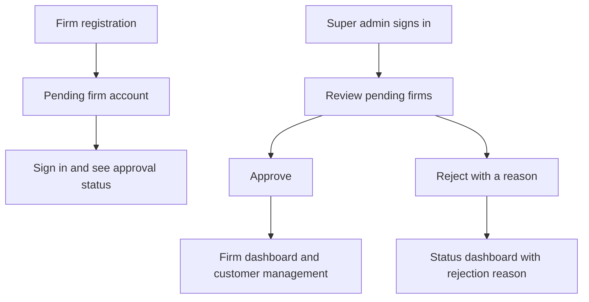

# MLMS — firms, customers, and loan requests

The application has a public welcome page and three workspaces: a super admin reviews firm registrations, an approved firm manages its own customers, and customers request loans and track their applications. Manager, accountant, and recovery officer dashboards remain placeholders.



## Setup

Requires PHP 8.1+ with PDO MySQL and mbstring, and MySQL 8+ or MariaDB 10.4+.

The default database is the existing local `money_lending_db`. Override configuration with `DB_DSN`, `DB_USER`, and `DB_PASSWORD`. For a different web mount, set `APP_BASE_PATH`, for example `/class_learning/PDO` (use an empty value if serving the PDO directory at `/`).

From the project root:

```bash
php PDO/database/migrate.php
php PDO/database/create_super_admin.php --name='Platform Admin' --email='admin@example.com'
```

The second command prompts for a password of 12–72 bytes. It creates a new super admin; it never promotes or resets an existing account. Existing super admins can use their current credentials. There is no public super admin registration or default password. Automated setup may supply `SUPER_ADMIN_PASSWORD` in the environment instead of using the prompt.

The migration is safe to rerun. It creates missing account/customer and lending tables, adds the `FIRM` and `CUSTOMER` roles, enforces one firm per owner account, and adds nullable `customers.firm_id`. It preserves existing records and loan product settings. A fresh installation needs active products configured in `loan_products`; the migration does not seed rates or products. Existing customers with no firm remain manageable only by super admins; this release does not assign those records to a firm automatically.

## Use the application

Start at [Welcome](http://localhost/class_learning/PDO/index.php). Choose customer sign in or staff and firm sign in. Signed-in users are taken to their dashboard.

1. A firm owner opens `registerFirm.php` and submits business details, owner details, and a password.
2. The application creates the account and firm together in a transaction. The account always receives `FIRM`, and the firm always starts `PENDING`.
3. The owner can sign in to `dashboard.php` to track approval. Pending and rejected firms cannot access customers.
4. A super admin signs in to the approval dashboard, reviews the registration, and approves it or rejects it with a reason.
5. An approved firm sees customer counts and links to register, list, search, view, and edit its customers. Approval becomes visible on the next page load, including in existing sessions.
6. Super admins can view and manage all customers. Customers created directly by a super admin have no firm assignment.
7. In a customer’s detail page, choose **Customer login access**. Enter an email and a password of 12–72 bytes to create a `CUSTOMER` account linked to that profile. Give the credentials to the customer directly. Existing accounts cannot be attached or reset through this form.
8. The customer signs in at `customerLogin.php` to see their profile, firm contact information, request counts, and paginated applications. A pre-existing customer account without a linked profile sees instructions to contact the firm.
9. A customer with `VERIFIED` KYC and an approved firm chooses **Request a loan**, selects an active product, and enters the amount, term, and purpose. The server checks the product’s amount range and maximum term. Requests start as `SUBMITTED` and use the authenticated customer and user IDs.
10. Opening a request shows its status, purpose, amount, term, decision date, approved amount, and rejection reason when applicable. If an issued loan exists, the customer also sees principal, agreed interest, total payable, outstanding balance, and disbursement/maturity dates. This portal reads decisions from the existing lending tables; loan review, approval, disbursement, and repayment administration are outside this change.

National IDs remain unique across the whole system. A firm cannot create a second customer with a national ID that is already registered.

## Request handling and access

Views display forms and data. Form submissions use explicit `action` attributes:

| Handler | Purpose |
| --- | --- |
| `auth.php` | Login, firm registration, and logout through POST |
| `firm.php` | Super admin approval/rejection through POST |
| `customer.php` | Customer create/update through POST; search through GET |
| `customerAccount.php?id=…` | Firm-scoped customer login creation through POST |
| `loan.php` | Customer loan submission through POST; owned request details through GET |

All state changes require a session CSRF token. Login regenerates the session ID. Passwords are hashed, and five failed attempts lock an account for 15 minutes. Passwords are excluded from validation state. Session cookies are HttpOnly and SameSite=Lax, and Secure when served through HTTPS. Authenticated roles, active status, firm ownership, and approval status are loaded from the database on each request.

Customer pages and model queries enforce access. Firm ownership and the registering user are taken from the signed-in account, ignoring submitted ownership fields. Search, pagination, detail views, edits, KYC queries, and deletes share the same firm scope. A firm cannot access another firm's customers by changing a URL or form ID.

The customer portal scopes profile and application queries by the signed-in user’s linked customer record. Customers cannot open staff customer-management pages or another customer’s loan detail URL. Submission rechecks verification, firm approval, and the product rules in a transaction. A single-use session form token prevents repeat submissions from the same form in addition to CSRF protection. Internal manager notes are not displayed to customers.

The old `PDO/users/` exercise scripts are CLI-only so they cannot bypass web authentication. Setup scripts are also CLI-only.

## Files

```text
PDO/
├── index.php, login.php, customerLogin.php, registerFirm.php, dashboard.php
├── customerAccount.php, requestLoan.php, loan.php
├── auth.php, firm.php, customer.php       # Submission handlers
├── includes/                             # Session, access checks, navigation, layout
├── assets/app.css                        # Account and dashboard styles
├── config/config.php                     # Shared PDO connection
├── modules/
│   ├── AuthService.php                   # Login and atomic firm registration
│   ├── CustomerPortalService.php         # Owned loan queries and submission validation
│   ├── firmModel.php                     # Registration review and reporting
│   ├── customerModel.php                 # Customer queries with firm scope
│   └── baseModel.php                     # Prepared statement helpers
├── controller/CustomerController.php     # Customer validation and operations
├── view/customers/                       # Existing customer pages
├── view/dashboards/                       # Super admin and firm dashboards
├── database/                             # Schema, migration, super admin setup
└── tests/                                # HTTP + database integration checks
```

## Verification

```bash
find PDO -name '*.php' -print0 | xargs -0 -n1 php -l
python3 PDO/tests/workflow_test.py
```

The integration test starts a local PHP server, applies the additive migration, creates randomly named temporary accounts, customers, products, applications, and loans, and removes those test records in `finally`. Run it against a development database. It checks firm registration and approval, account protection, customer provisioning and role restrictions, loan validation, duplicate submission prevention, decision/balance display, and isolation between firms and customers. See `TESTING.md` for browser checks.
