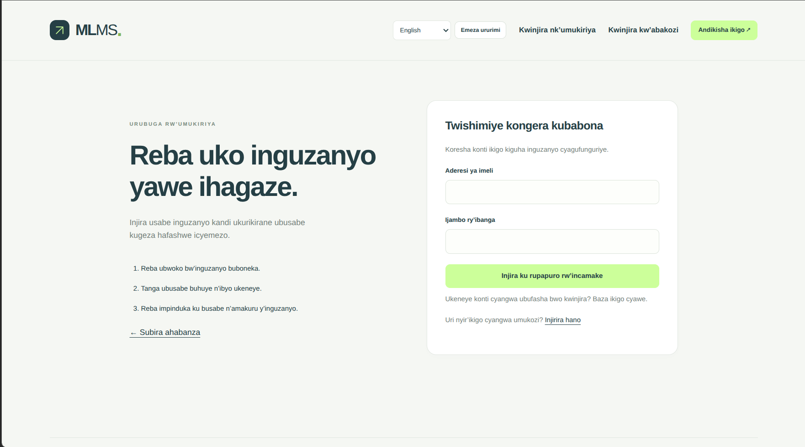

# MLMS — lending management

A PHP/PDO and MySQL lending system with six role-based workspaces. The interface uses `#203D43` and `#CDFF9B`, shared responsive layouts, and no frontend framework or build step. It supports English (default), French, and Kinyarwanda.



Customer sign-in in Kinyarwanda. Customers use accounts created by their lending firm to upload verification documents, apply for available loans, and track their repayments and remaining balances.

[Quick start](QUICKSTART.md) · [Folder guide](docs/ARCHITECTURE.md) · [Translations](docs/I18N.md) · [Testing](TESTING.md)

## Start

Requires PHP 8.1+ with PDO MySQL, mbstring, and fileinfo; MySQL 8+ or MariaDB 10.4+.

```bash
php PDO/database/migrate.php
php PDO/database/create_super_admin.php --name='Platform Admin' --email='admin@example.com'
```

The second command prompts for a 12–72 byte password. Existing accounts are preserved. Open `http://localhost/class_learning/PDO/` and sign in with your existing account or the newly created administrator.

Configuration uses `DB_DSN`, `DB_USER`, and `DB_PASSWORD`, with the existing local database configuration as the fallback. Set `APP_BASE_PATH` when using a different web mount (an empty value serves the PDO directory at `/`). Dates use Africa/Kigali.

The rerunnable migration preserves existing records, customer passwords, role IDs, and agreed loan terms. It adds staff/product firm assignments, password-change metadata, document review metadata, customer payment submissions, and transaction-reference reservations. A fresh database receives the six specified roles, including `FIRM` at ID 9. Roles are resolved by name throughout the application. No sample products or rates are seeded.

## Workflow

1. A firm owner registers. A super admin approves or rejects the firm from the overview.
2. The approved firm registers customers. Entering an email creates their login automatically with initial password **`customer123456789`**. Without an email, use **Customer login access** on the customer's profile later. Customer registration and login creation commit together; duplicate account emails roll back the registration.
3. The super admin opens **User accounts** to create managers, accountants, and recovery officers, assigning each to an approved firm. Existing staff accounts also need a firm assignment there.
4. Customers sign in with the default password and must set a personal password before accessing the portal. They then browse their firm's active products and upload their national ID, proof of income, and optional supporting documents in **My documents**. PDFs, JPEGs, and PNGs are supported, up to 5 MB per document.
5. The firm owner downloads and approves or rejects the latest documents. Rejection requires a reason visible to the customer. Both the current ID and income document must be approved before applying. Replacing either sends it back for review. Profile editing cannot bypass this requirement.
6. A verified customer applies for an active product within its amount and term limits. Products requiring collateral also require an approved supporting document. The manager consults the documents and approves, rejects, or marks the application under review. Approval creates an issued loan, with its own agreed terms, awaiting disbursement.
7. An accountant records the actual disbursement, method, date, and unique reference. This activates the loan and generates its monthly repayment schedule.
8. Customers make bank/mobile money transfers using instructions supplied by their firm and submit the transaction reference through **Repayments**. An accountant verifies the transfer and confirms or rejects it. Pending submissions do not reduce the loan balance. Cash and other confirmed receipts can be posted directly by an accountant.
9. Posting a repayment creates a receipt, allocates the money to the schedule, updates the remaining balance, and completes a fully paid loan in one transaction. Customers see schedules, confirmed payment history, submission review notes, loan status changes, and printable receipts that can be saved as PDFs.
10. Recovery officers work the overdue queue and record calls, visits, SMS, or warning letters, with promised payment and follow-up dates. Managers and accountants can read collection/disbursement reports. Super admins can also read audit logs and manage account access.

## Lending rules

- Firm owners create and edit products under **Loan products**. Only customers belonging to that firm can see or apply for its active products. Two firms may use the same product name. The server takes ownership from the signed-in firm and rechecks it during application submission and approval. Managers can read their firm's products; super admins manage products across firms.
- Existing products have no inferred owner. A super admin can assign an unassigned product to an approved firm. If its application history spans other firms, create separate firm products instead; historical loan records remain accessible and unchanged. Owned products cannot be transferred to another firm through the product form.
- **Interest is flat and applied once to the approved principal for the entire loan**, regardless of term. The UI labels this explicitly. The manager sees the product rate before approval; issued loans retain their agreed rate when products change.
- Monthly principal and interest installments are split using integer cents; any rounding remainder goes into the final installment. Monthly dates retain the original day where possible (31 January → 28/29 February → 31 March).
- Repayments go to the oldest installment first, then penalty, interest, and principal within that installment. New automatic late fees are not accrued by this implementation. Existing scheduled penalties are included in schedule reconciliation.
- Amounts use integer cents in the ledger code. Overpayments, repeated disbursements, duplicate references, and reused financial form submissions are rejected. A payment cannot predate disbursement, a later posted payment, or use a future date.
- Overdue status is computed from unpaid past-due installments whenever records are read, so queues and customer views update without a cron task. Loan status transitions caused by approval, disbursement, and repayment are recorded in history.
- Legacy loans whose stored balances do not reconcile with their schedules require reconciliation before posting new payments. No existing balances or schedules are silently rewritten.
- Bank/mobile transfers happen outside this application. No payment gateway is connected and the application does not initiate transfers.

## Private documents

Set `DOCUMENT_STORAGE_PATH` to a **persistent private directory outside the web root**, writable only by the PHP service account. When unset, development uploads use a project-specific directory under the operating system's temporary directory. That fallback can be cleared by system maintenance; configure persistent storage and backups before storing real documents.

The database stores random file keys, original filenames, detected MIME types, sizes, and review details in `customer_documents`. Downloads require authentication and ownership/firm access checks. File paths from older systems are not served as arbitrary filesystem paths; migrate those files into private storage before using their download links.

The included `.user.ini` sets `upload_max_filesize=5M` and `post_max_size=8M` for PHP-FPM/CGI. For Apache mod_php, configure those limits in the server configuration. If Apache runs as a different account from your shell, ensure the configured private directory belongs to that PHP account.

## Access

| Role | Workspace |
| --- | --- |
| SUPER_ADMIN | All firms, approvals, user accounts, products, lending operations, reports, audit logs |
| FIRM | Own customers, login provisioning, product creation/editing, document review, own applications and loan portfolio |
| MANAGER | Assigned firm's applications, document consultation, loan portfolio, reports; reads product configuration |
| ACCOUNTANT | Assigned firm's disbursements, repayment posting/confirmation, receipts, reports |
| RECOVERY_OFFICER | Assigned firm's overdue queue, loan details, borrower contact logs |
| CUSTOMER | Password changes, own documents, applications, loans, schedules, payment submissions, receipts; own firm's active products |

Every request reloads the account's role, active status, firm assignment, firm approval, and password version. Tenant scope is enforced in database queries, including direct URLs and downloads. Customer/staff identities and ownership are taken from the session, never submitted form fields. State changes require POST and CSRF tokens. Financial operations use database transactions and row locks. Passwords are hashed in the existing `users.password_hash`, linked through `customers.user_id`; no plain-text password is stored in customers. Five failed sign-in attempts lock an account for 15 minutes. Session IDs rotate at login and password change. Changing a password invalidates older sessions. Legacy exercise and setup scripts are CLI-only.

Existing customer passwords are not reset. New customer logins require a password change; other customer sessions can use **Change password** at any time. Personal passwords require 12–72 bytes and cannot be the default password. Reopening **Customer login access** never resets an existing account.

## Structure

```text
PDO/
├── index.php, dashboard.php # Welcome page and role-based overview
├── *.php                   # Existing public URLs delegate to the folders below
├── actions/                # Authentication, customer/firm forms, language selection
├── app/                    # Business classes, grouped by feature; autoload.php
│   ├── Auth/               # Sign-in and password changes
│   ├── Customers/          # Customer records, login provisioning, portal queries
│   ├── Firms/              # Firm registration and approval
│   ├── Http/Controllers/   # Customer request coordination
│   ├── Lending/            # Access, documents, loans, accounting, administration
│   └── Support/            # Base model and translation helpers
├── resources/lang/         # en.php, fr.php, rw.php translation catalogs
├── portal/                 # Customer applications, documents, payments, receipts
├── workspace/              # Staff decisions, portfolio, reports, products, users
├── view/                   # Auth screens, customer management, dashboard partials
├── includes/               # Bootstrap, shared layout, navigation, language switcher
├── assets/                 # Shared CSS and JavaScript
├── config/                 # Database configuration
├── database/               # Migrations and CLI administrator setup
├── examples/users/         # CLI-only learning exercises
├── docs/                   # Folder guide and translation maintenance
└── tests/                  # Integration, catalog, and optional Chrome checks
```

See the [folder guide](docs/ARCHITECTURE.md) for where to add new code and how requests reach the services. Existing page URLs continue to work, and the class move preserves the default private document storage location.

## Languages

Choose **English**, **Français**, or **Kinyarwanda** in the page header and apply the selection. The choice is remembered in the session and a one-year browser cookie, including through sign-in and sign-out. A new browser starts in English. Switching language keeps the current screen and query filters; it reloads the page, so save unfinished forms first.

Navigation, forms, validation, statuses, dates, money displays, receipts, and browser loan estimates are translated. Product names, document filenames, customer details, and notes remain as entered. Language selection does not change database status codes, stored dates, amounts, or agreed loan terms. See [translation maintenance](docs/I18N.md).

## Verify

```bash
find PDO -name '*.php' -print0 | xargs -0 -n1 php -l
node --check PDO/assets/app.js
php PDO/tests/i18n_catalog_test.php
python3 PDO/tests/workflow_test.py
# Optional, using an installed Chrome browser (CHROME_BIN overrides its path):
RUN_BROWSER_QA=1 python3 PDO/tests/workflow_test.py
```

Run integration tests against a development database. Tests create uniquely named temporary users, firms, customers, products, documents, applications, loans, schedules, and payments, then remove their records. Browser checks use temporary sessions/profiles, verify desktop/mobile layouts, and save screenshots to `/tmp/mlms-ui-preview`. See `TESTING.md` for manual checks.
